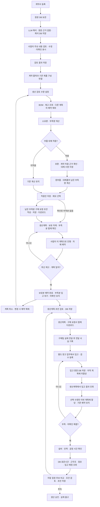

# A 생산계획 업무 흐름

최종 갱신: 2026-10-31. **업무 단계·분기·저장 시점이 바뀌면 이 문서와 화면을 함께 갱신한다.** 기존 웹 시나리오 문서는 개별 검증 기록이며 이 문서가 현재 전체 흐름의 기준이다.

## 단계와 저장의 의미

| 단계 | 현재 처리 | 저장/상태 |
|---|---|---|
| 계약 접수·해석 | 원본을 보관하고 실제 모델 호출로 해석한다. 등록 흐름에서 해석이 연이어 실행될 수 있다. | 원본, 해석, 사람 수정/확인 기록을 구분하여 보존 |
| 제품 연결·소요량 | DB의 제품 구성/BOM과 입력한 생산 검토 수량 사용 | 구성 연결 및 계산 결과 저장. 미확인 값은 0 아님 |
| 특정 부품 대체 | 승인 근거가 있는 대상만 수량 적용. 제품 전체 개정/BOM 불변 | 부품별 검토 및 선택안 저장. 가상 승인·재고는 별도 표시 |
| 구매 요청 초안 | 선택안의 남은 부족량 사용 | DB 저장·다운로드. 실제 전달/발주 아님 |
| 계획 확인·자재 예약 | 선택된 생산 수량/대체품/보유분/부족분을 확인하고 명시적으로 예약 | A 전용 예약 원장. 실제 출고·생산 승인 아님 |
| 생산계획 초안 | 예약 자재·대체품·입고 대기·미확인 조건을 함께 검토 | DB에 버전별 저장. 구매 요청 초안과 함께 TXT 다운로드. 생산 가능 수량·완료일 확정/생산 승인이 아님 |
| 예약 해제 | 사용자가 해당 계획의 예약을 해제 | 해제자·시각 및 기존 예약 본문 보존. 구매 요청 취소 아님 |
| 구매 전달 | 실제 전달 후 담당자·채널·근거 기록 | 자동 발송·발주 기능 아님 |
| 창고 입고·검수 | 별도 창고 화면에서 도착·합격·불합격·대기 등록 | 입고 원장 DB 저장. 계획 예약은 변경하지 않음 |
| 입고 자재 할당 | 생산계획에서 DB 입고 결과를 조회하고 수량 선택 | 합격 잔량·계획 부족량 범위 안에서 기존 예약에 추가 |
| 생산 일정 | 부족·미확인 해소 후 설비·인력·공정 시간 확인 | 연속 작업 조건부 완료일 저장. 생산 승인·출고는 후속 |

## 예약 규칙과 경계

- 계약 ID + 품목 순번이 현재 A 화면의 계획 식별자다. 동일 품목을 여러 독립 생산계획으로 쪼개는 기능은 아직 없다.
- 예약 수량 = min(알려진 필요 수량, 다른 A 계획 예약을 제외한 가용재고). 미확인 수량은 자동 예약하지 않는다.
- 원부품과 적용한 대체품 모두 예약 대상이다. 구매 초안이 있는 부족분도 입고되기 전에는 예약하지 않는다.
- ‘입고 대기’는 미확보 상태다. 화면에서 구매 초안 유무를 구분하며 초안을 발주 완료로 간주하지 않는다.
- 같은 계획의 동시 클릭/다른 요청 키도 활성 예약은 한 건. PostgreSQL의 공통 호스트 트랜잭션 잠금을 재사용해 최신 기준 검사와 예약 삽입을 함께 수행한다.
- 다른 계획 예약이 바뀌면 오래된 소요량/선택안으로 추가 예약하지 못한다. 최신 재고로 재계산하고 다시 확인한다. 자기 예약은 자기 계획의 가용분에서 재차 빼지 않는다.
- 기존 예약이 있는 상태에서 계약·적용안을 바꿔도 예약을 몰래 해제하지 않는다. 변경 경고와 기존 예약을 보여주며 명시적으로 해제 후 새 계획을 예약한다.
- A 계약 보관함의 소요량·대체 계산·예약 경로에 연결했다. 공통 그래프·재고 숫자를 덮어쓰지 않는다. 외부 ERP나 다른 독립 시스템을 차단하는 통합 기능은 아니다.
- 현재 동일한 정확한 component ID를 하나의 보수적인 A 재고 풀로 취급한다. 창고별 독립 예약이나 원본 범위가 다른 ID 사이의 같은 실물 판정은 지원하지 않는다. 운영 통합 전 회사/창고/로트 식별과 스냅샷 예약 반영 계약이 필요하다.

## 이번 검증 시나리오

1. 구매 초안 화면 → ‘생산계획 확인·자재 예약’.
2. 120대와 대체 저항30개, 원부품 저항 남은10개 등 선택안 확인.
3. 전체 확인 후 예약. 알려진 보유분만 예약되고 미확인 조건은 유지.
4. 새로고침/재클릭에서도 동일 예약. 다른 계획의 가용재고는 예약분만큼 감소.
5. 예약 해제 후 가용재고 복원. 기록은 삭제하지 않는다.

가상 운영 자료로 기능을 검증하는 단계이며 실제 OLIMEX 생산·구매·창고 운영 성공을 의미하지 않는다.

검증 완료: 전체640개·관련88개 및 공통 demo 통과. 실제 브라우저에서는 예약 전 계획 확인 화면까지 검증했고, 예약 저장/동시 경쟁/해제는 격리 PostgreSQL로 검증했다. 사용자 계약의 예약 확정은 직접 클릭하도록 남겨두었다.

## 생산계획 초안 검토 (2026-10-31 추가)

예약 완료 → 생산계획 초안 검토 → 전체 확인·저장 → 생산계획·연결된 구매 요청서 함께 다운로드.

- 실제 DB의 현재 예약, 선택안, 계약 해석/사람 검토, 현재 선택안에 연결된 구매 초안을 읽는다. 화면 고정 값이나 새 LLM 추측으로 계획을 생성하지 않는다.
- 부족이 있으면 일부 확보·자재 확보 조건부, 미확인 조건이 있으면 확인 대기다. 자재가 모두 확보돼도 생산 승인·설비/인력/공정 일정 검토는 별개다.
- 생산 가능 수량은 미확정으로 둔다. 완료일은 자재 조건과 일정 검토가 끝나기 전까지 미확정이며, 후속 일정 검토가 유효하면 조건부 완료 예정일을 표시한다. 고객 납기와 생산 완료일을 혼동하지 않는다.
- 검토 의견은 선택 입력. 동일 최신 내용의 재클릭은 같은 문서 반환, 수정은 새 문서로 보존한다.
- 저장 시 기준 해시를 트랜잭션 안에서 재검증한다. 예약 해제·선택안/계약/구매 초안 변경 시 이전 문서를 최신으로 저장/다운로드하지 못한다. 기존 본문은 이력으로 보존한다.
- 출력 TXT는 생산계획과 현재 구매 요청 초안을 합친 검토용 문서다. 실제 전달·발주·출고를 실행하지 않는다.

생산계획 초안 추가 후 검증: 전체640개 OK (243.058초), 관련67개 및 저장조회88개/공통 demo 통과. 실제 브라우저는 사용자120대 계약의 초안 검토 화면에 열어 두었으며 최종 저장은 사용자가 진행한다.

가독성 개선: 생산계획 검토 화면을 요약 카드, 입고 대기 자재 표, 확보 자재 펼침, 대체품, 확인 조건, 구매 요청 연결 상태로 구분했다. 전체 문서는 펼쳐 보기로 제공한다. 저장 본문·계산·승인 경계는 변경하지 않는다.

## 구매 전달·입고·일정 검토 (2026-10-31)

예약 또는 생산계획 화면 → **구매 전달·입고·일정 검토**.

1. 저장된 구매 요청서를 확인·다운로드하고 기존 업무 채널로 구매팀에 전달한다. 화면에서는 선택 메모와 함께 ‘전달 완료로 기록’을 누른다. 기록 번호·확인 시각·처리자는 자동 저장하며 이미 전달한 요청은 완료 상태로 표시한다. 확인 시각은 실제 발송 시각을 증명하지 않는다. 서비스가 메일을 보내거나 발주하지 않는다.
2. 구매·창고 담당자가 확인한 입고·검수 결과를 입력한다. 도착 = 합격 + 불합격 + 검수 대기. 합격분만 동일 부품의 회사 재고와 해당 계획 예약에 추가된다. 다른 계획은 추가 할당분을 사용할 수 없다.
3. 원래 예약 본문은 유지하고 A 전용 `pp_supply_events`의 기록으로 유효 확보량을 계산한다. 같은 기록 번호 재전송은 재가산하지 않으며 다른 내용은 거부한다. 구매 요청 누적 도착량과 미확보량 초과는 거부한다. 예약을 해제해도 이미 입고된 재고는 남는다.
4. 부족·자재 미확인·계약 미확인 조건을 모두 해소해야 일정 저장이 가능하다. 담당자가 확인한 시작 가능 시각에 준비+전체 생산량 공정+검사 시간을 더한다. 휴무·교대·병렬 공정·설비 예약 충돌을 계산하는 캘린더 엔진이나 생산 승인은 아니다.
5. 입고나 전달 기준이 바뀌면 저장된 생산계획 초안은 이전 버전으로 남으며 갱신 내용을 다시 확인·저장한다.

경계: 외부 ERP 자동 수신은 없으며 담당자의 근거를 수동 반영한다. 검수 대기 재판정·반품·정정 원장은 후속이며 현재는 완료된 검수 단위로 등록한다. 입고 원장과 기준 재고 스냅샷의 중복 합산을 막기 위해 입고 이력이 있는 부품의 기준 재고/대체품 재고 교체는 대사 기능 도입 전 차단한다. 회사/창고/로트별 재고 통합은 아직 아니다. 공통 model.py·T-box는 변경하지 않고 A 업무 DB 테이블만 확장했다.

최종 검증: Ran 641 tests in 269.050s / OK. A 관련89개 및 공통 demo 통과. 실제 사용자 DB에는 전달/입고 사실을 생성하지 않았으며 브라우저 조회·빈 제출 차단 확인. 증빙 /tmp/ontologics-supply-workflow.png.

## 창고 등록과 생산계획 할당 분리 (2026-10-31)

현재 흐름은 위의 종전 ‘입고 입력과 즉시 할당’을 대체한다.

- 창고 화면: 구매 요청에 연결된 입고·검수 근거를 A 전용 `pp_warehouse_receipts`에 저장한다. 도착=합격+불합격+대기, 요청량 초과·미래 일시·문서번호 중복/충돌을 검사한다. 원본 검수 결과는 수정하지 않는다.
- 생산계획 화면: 필요 수량/현재 부족량, 합격 수량, 이미 할당된 수량, 입고 잔량을 DB에서 조회한다. ‘이번 계획에 할당’으로 선택 수량을 별도 allocation 이벤트에 저장한다. 사용자 입력으로 입고 수량을 다시 쓰지 않는다.
- 미할당 합격분은 입고 대기 재고로 분리하여 일반 보유재고 계산에 중복 노출하지 않는다. 원장 합격 총량은 재고에 반영하되 미할당분은 별도 대기량으로 제외한다. 할당하면 대기량에서 계획 예약으로 옮겨진다.
- 할당은 공통 호스트의 기존 트랜잭션 잠금 아래 최신 계획/입고 잔량을 다시 검사한다. 요청 재전송과 동시 할당에서 중복·초과 사용을 막는다. 기존 예약은 보존한다.
- 예약 해제 시 이미 할당된 입고분은 일반 가용재고로 풀린다. 창고 입고 원장의 미할당 잔량으로 되돌리지 않아 이중 재사용하지 않는다.
- 창고/생산계획은 화면·업무 경로를 분리했다. 별도 사용자 역할 도입 없이 기존 공통 review 권한을 사용하며, 실제 창고 계정·ERP 연동은 아직 아니다.
- 예전 receipt 이벤트는 기존 데이터 호환을 위해 읽되 새 웹 입고 등록은 warehouse-register만 사용한다.

테스트 자료 등록: `python -m ontologics.production_planning.warehouse_demo --contract-id <계약ID>` (DB 환경이 설정된 상태). 명시적 실행 시에만 synthetic 입고를 등록하며 계획 할당은 실행하지 않는다. 현재 사용자 계약에는 LAN 10개 부분 입고, 저항10개·WROOM40개·TPS120개 합격 입고 총4건을 넣었다. 실제 납품 사실이 아니다. 브라우저에서 등록 자료를 읽고 직접 할당할 수 있다.

창고 분리 최종 검증: Ran 642 tests in 275.038s / OK. 관련90개(동시 할당·중복/초과 방지·권한·해제 후 재고 보존 포함) 및 공통 demo 통과. 실제 DB 테스트 입고4건, 브라우저 별도 창고 조회/생산계획 할당 화면 확인. 사용자 계획에는 아직 할당하지 않음. 화면 /tmp/ontologics-warehouse-allocation.png.

## DB 기준 생산 일정 자동화 (2026-10-31)

수동으로 기록 번호·설비·인력·준비/공정/검사 시간을 매번 작성하던 3번 화면을 대체한다.

- 생산관리의 기준 자료를 A 전용 RDB 테이블로 구분한다: `pp_schedule_resources`(라인), `pp_schedule_routes`(제품 구성별 표준·개정·유효기간), `pp_schedule_shifts`(라인 전담 근무조·시간·확보 인원), `pp_schedule_blocks`(기존 작업·보전 점유), `pp_schedule_arrivals`(구매 요청별 잔여 입고 예정). 각 기록은 ID·근거·자료 구분·해시·등록자·시각을 보존하며 같은 ID 덮어쓰기를 거부한다.
- 명시적 `python -m ontologics.production_planning.schedule_demo --contract-id <ID>`로 테스트 운영 자료만 등록한다. 화면 접근 시 시드를 넣거나 부족한 자료를 하드코딩으로 보충하지 않는다. 실제 OLIMEX 작업표준이나 가동 실적이 아니다.
- 제품 구성에 맞는 유효 표준에서 준비분 + 생산 수량×대당 초 + 최종 검사분을 계산한다. 필요한 인원이 확보된 게시 근무 구간만 사용하고, 휴게·야간·주말 및 기존 작업/점검 구간을 제외한다. 중단 재개 가능 여부도 표준 속성으로 관리한다.
- 미할당 합격 입고분은 할당 전제, 부족분은 유효한 입고 예정량/일시와 검수·할당 전제로 판단한다. 예정량이 부족하거나 예정일이 지난 경우 임의로 날짜를 만들지 않고 계산을 막는다. 미확인 자재·계약 조건은 일정의 명시적인 전제로 남긴다.
- 화면: ‘일정안 계산·검토’ → 후보별 시작/완료와 작업 구간·표준/근무/점유/입고 근거 확인 → 필요하면 시작 희망 일시 조정 → 확인하고 ‘일정 초안 저장’. 기록 번호·처리자·시각 자동 저장.
- `pp_schedule_proposals`에는 선택 후보와 자재 기준·운영 기준 해시를 저장한다. 저장 시 DB에서 다시 계산하고 비교한다. 기준이 바뀌거나 시작 시간이 지나면 이전 안은 보존하되 최신 계획에서 사용하지 않는다. 생산계획 초안에도 유효한 일정안과 조건을 표시한다.
- 일정 초안 저장은 설비/근무조 예약이나 생산 승인이 아니다. 현재는 전담 근무조·단일 라인 배치 작업 모델이다. 공유 인력 최적화, 여러 공정/설비를 병렬 배치하는 APS, 운송/고객 도착일 계산, 외부 MES/ERP 실시간 연동은 포함하지 않는다.
- 현재 미확인 11종을 임의로 해결하지 않는다. 조건부 일정이 있어도 자재 확보 상태와 실제 생산 승인 여부는 별개다.

일정 자동화 최종 검증: 전체 646개 테스트 통과(296.225초), 관련 DB/웹 회귀 91개 및 공통 demo 통과. 실제 사용자 DB의 운영 자료를 읽어 브라우저 일정 후보를 확인했으며 사용자 대신 일정 저장은 수행하지 않았다.
