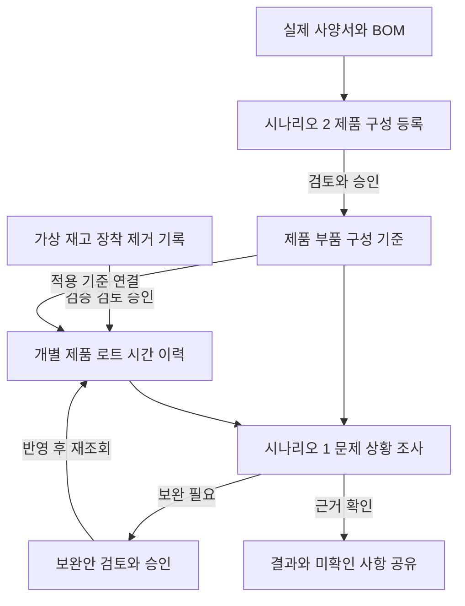

# 제조 제품정보 서비스 Codex 전달안

기준일: 2026년 10월 21일, 한국 시간. 버전: v2. 상태: 공통 기반을 먼저 구축하고 동료가 주로 Agent 개발을 맡는 방식의 인계본. 서비스 방향·데이터 정책·개발 방식의 확정사항과 추천안·미검증 사항을 구분한다.

서비스의 전체 범위에는 시나리오 1과 2를 모두 포함한다. 우선 목표는 **공통 PRD·CQ·개발 지침, T-box, 초기 지식그래프, 조회·검증·등록초안 도구가 연결되어 동료가 Agent 개발에 활용할 수 있는 기준 버전**을 만드는 것이다.

사용자와 Codex가 공통 기반을 먼저 마련하고, 동료들은 그 위에서 주로 Agent의 지시사항·추출·해석·도구 활용·대화·결과 설명을 개발한다. 병렬 착수를 앞당기는 것이 목표는 아니다. 관련 작업은 묶어서 진행하고 기존 문서와 검증 결과를 재사용한다.

현재 준비된 것은 기획 전달안과 진행표다. T-box·지식그래프·공통 도구가 구현되었거나 모든 BOM 행의 근거가 검증되었다는 뜻은 아니다. 실제 자료와 CQ를 대조해 필요한 설계를 정리한 뒤, 진행 가능한 공통 기능은 구현·실행 확인까지 이어간다.

## 1 서비스 목적과 회사 설정

주제는 **Ontology 기반 제조 Product 정보 생성 및 등록 자동화**다.

서비스는 사양서와 기존 BOM을 근거로 제품·구성 정보를 표준화해 등록하고, 이를 개별 제품의 부품·로트 이력과 연결하여 문제 상황 조사와 정보 보완을 지원한다.

회사 설정의 권고안은 **공개 설계 기준을 활용하는 가상 전자보드 제조·조립 회사**다. 제품정보 담당자, 자재·생산기록 담당자, 품질·기술 조사 담당자, 검토·승인 담당자가 사용자 역할을 나눈다. 한 사람이 여러 역할을 맡을 수 있지만 권한과 책임은 구분한다. 이 설정은 실제 OLIMEX 또는 한화의 내부 시스템과 운영을 재현한다는 뜻이 아니다.

제품정보를 등록하는 업무와 등록된 정보를 조사에 활용하고 보완하는 업무를 하나의 서비스로 설계한다. 전체 업무 범위를 먼저 정하고 구현 순서를 그 안에서 나눈다.

## 2 확정된 요구사항

| ID | 확정 내용 |
| --- | --- |
| D01 | 시나리오 1은 **문제 상황 분석 및 생산·사용 이력 보완**이다. |
| D02 | 시나리오 2는 **기존 구성 기준에 연결해 제품을 등록하는 업무**다. 과거 예시의 번호로 되돌리지 않는다. |
| D03 | BOM 생성은 **사양서·BOM 원본을 읽어 시스템에 등록할 구조화된 BOM 정보를 만드는 것**이다. 원본에 없는 부품 조합이나 호환성을 설계해 채우는 의미가 아니다. |
| D04 | OLIMEX의 실제 공개 사양·설계·BOM을 최대한 활용한다. 제품 특성·부품 구성·옵션 조건은 확인한 원본에 근거한다. |
| D05 | 가상 회사의 재고·입출고 및 **장착·제거 기록**을 허용한다. 이를 연결할 개별 제품·부품 로트 식별 정보도 시연 데이터로 준비할 수 있다. |
| D06 | A인 특정 시점 질문과 B인 조사 기간 질문을 모두 유지한다. B의 정확한 업무 의미와 시간 경계는 10절에서 명문화한다. |
| D07 | 서비스를 탑다운으로 정의한다. 구현 우선순위를 정하더라도 두 시나리오와 이력 보완을 전체 범위에서 임의로 제외하지 않는다. |
| D08 | 사용자와 Codex가 공통 기준·데이터·도구를 먼저 마련하고, 동료는 같은 기준 위에서 주로 Agent를 개발한다. 기본 역할은 필요에 따라 추가·분리·통합할 수 있다. |
| D09 | 과도한 작업 세분화, 중복 조사·문서·검증, 불필요한 프레임워크를 줄인다. 업무 결과 단위로 진행하고 공통 문서·코드·도구를 재사용한다. |

가상 데이터 허용은 가상의 검사 결과·고장 원인·불량률·가동 시간까지 포괄하는 결정이 아니다. 조사 요청은 사용자의 입력으로 접수하고, 현재 확보한 근거가 뒷받침하는 범위에서 관련 대상과 기록을 확인한다.

## 3 자료와 개념의 구분

| 개념 | 의미 | 예시 또는 관계 |
| --- | --- | --- |
| 사양 자료 | 제품이나 부품의 특성·성능·사용 조건을 설명하는 근거 | 모델, 인터페이스, 전원 조건, 크기 등 원본에서 확인한 속성 |
| 설계 BOM | 제품 구성을 이루는 부품과 소요량의 기준 | 제품 구성 → BOM 항목 → 부품 모델 |
| 제품 모델·개정·변형 | 제품의 정의와 적용할 설계·선택 조건 | 개정과 고객 선택 옵션을 서로 다른 개념으로 관리 |
| 개별 제품 | 한 대 또는 한 개의 실물 대상을 식별하는 기록 | U104 같은 시연 식별자. 정확한 관리 단위는 미결정 |
| 부품 모델 | 부품의 종류와 사양을 식별 | 같은 부품 모델에 여러 로트가 연결될 수 있음 |
| 부품 로트 | 회사 업무에서 관리하는 부품 묶음의 식별 | 로트명 문자열만으로 다른 부품·공급처의 로트를 합치지 않음 |
| 재고·입출고 | 보유·입고·출고 등 자재의 운영 기록 | 출고만으로 장착 완료를 추론하지 않음 |
| 장착·제거 | 개별 제품과 부품 로트 사이의 시간에 따른 연결 기록 | 대상 제품, 부품·로트, 위치 또는 적용 범위, 사건 시점, 근거 |
| 검토·승인 이력 | 서비스에서 수행한 등록·수정·확정 과정 | 누가 어떤 등록안 버전을 검토하고 승인했는지 |
| 원본 근거 | 각 주장과 값이 나온 자료 및 위치 | 문서·파일 버전, 페이지·표·행, 수집 시점 등 |

PDF인지 CSV인지가 사양서와 BOM을 나누는 기준은 아니다. BOM이 이미 CSV 등으로 구조화돼 있다면 파서로 읽고 필드·식별자·관계를 맞춘다. 모든 입력을 OCR 또는 LLM으로 처리하도록 강제하지 않는다.

사양서만으로 구성 전체를 확인할 수 없다면 제품 속성만 등록하고 검증된 기존 BOM 연결 또는 보완 자료를 요청한다. BOM만 있다면 구성 관계를 등록하고 상세 부품 속성은 확인 가능한 사양 자료에 연결한다.

## 4 전체 업무 범위

| 영역 | 업무와 결과 |
| --- | --- |
| 원본 자료 관리 | 자료 접수, 읽기 가능 여부 확인, 문서 종류·대상 파악, 원본·버전·근거 위치 보관 |
| 제품·구성 등록 | 추출·정규화, 기존 제품·부품 연결, 개정·변형 확인, 차이·충돌 제시, 검토·승인 후 등록 |
| 재고·운영 이력 | 개별 제품·로트 식별, 재고·입출고, 장착·제거 사건 및 근거 연결 |
| 문제 상황 조사 | 요청 조건 확인, 제품·구성·로트·시간 이력 조회, 포함·조건상 제외·추가 확인 이유 설명 |
| 보완과 재조회 | 누락·오류 기록의 보완안 작성, 검토·승인, 이력 반영, 동일 조건 재조회 |
| 공유와 추적 | 조회 조건, 근거, 적용 데이터 버전, 변경점, 미확인 사항을 함께 제시 |

업무별 챗봇은 현재 제품 또는 조사 건의 맥락을 활용하는 인터페이스로 설계한다. 챗봇을 추가한다는 이유만으로 별도 Agent를 반드시 만들지는 않는다.

## 5 시나리오와 완료 기준

### 시나리오 2 제품 등록

업무 시작: 새 사양서·BOM을 받았거나 기존 자료의 다른 개정·변형을 등록해야 한다.

1. 자료의 종류와 대상 제품·개정·변형을 확인한다.
2. 속성과 구성 정보를 추출하거나 가져와 표준 필드로 정리한다.
3. 기존 제품·부품·구성 기준과 연결 후보 및 차이를 제시한다.
4. 불명확한 연결, 누락, 원본 간 충돌을 검토 대상으로 표시한다.
5. 담당자가 수정·보완하고 검토자가 특정 등록안 버전을 승인한다.
6. 승인한 정보를 등록하고 원본 근거·변경 이력을 남긴다.

완료 기준: 승인된 제품정보·구성 버전과 원본 근거를 다시 확인할 수 있고, 등록 결과를 이후 조사에 사용할 수 있다. 동일 자료의 반복 접수와 다른 개정의 접수를 구분해야 한다. 구체적인 중복·동일성 규칙은 근거표와 함께 확정한다.

### 시나리오 1 조사와 이력 보완

업무 시작: 특정 제품·부품·로트에 대한 확인 요청이나 이력 조사 요청이 들어온다.

1. 대상과 조사 목적을 접수하고 A의 시점 질문인지 B의 기간 질문인지 확인한다.
2. 제품 구성 기준과 개별 제품·로트의 운영 이력을 연결해 조회한다.
3. 포함·조건상 제외·추가 확인 필요와 그 이유·근거를 보여준다.
4. 누락 또는 충돌 때문에 판단이 어려우면 필요한 자료를 구체적으로 안내한다.
5. 추가 기록을 근거로 보완안을 만들고 검토·승인한다.
6. 승인된 데이터를 반영하고 같은 조건으로 재조회한다.
7. 조건, 이전·이후 데이터 버전, 추가 근거, 결과 변화와 남은 미확인을 공유한다.

완료 기준: 조사 대상과 조건, 판단 근거, 확인 한계가 설명되고, 보완한 이력을 추적하며 같은 조건의 재조회 결과를 확인할 수 있다. 현재 범위의 완료는 근거 있는 이력 조사와 보완이다.

### 전체 연결

## 6 CQ 근거표 초안

아래는 질문의 시작 목록이다. 각 CQ의 적용 원본, 정확한 입력, 예상 답변과 근거 위치는 실제 파일 및 샘플 운영 기록을 대조해 완성한다. 아직 모든 CQ의 원본 대응이 검증된 상태는 아니다.

| CQ | 질문 | 필요한 근거 | 기대 결과의 형태 |
| --- | --- | --- | --- |
| CQ01 | 이 자료는 어느 제품·개정·변형의 자료인가? | 실제 원본의 식별 정보와 기존 기준 | 확인된 대상과 근거 또는 연결 후보·추가 확인 사유 |
| CQ02 | 확인한 사양과 BOM 항목을 어떤 표준 항목·기존 품목에 연결할까? | 원본 속성·품번·수량과 기존 품목 | 등록안, 연결 근거, 미확정 필드 |
| CQ03 | 기존 구성과 개정 간 무엇이 달라졌는가? | 비교 가능한 두 원본과 등록 버전 | 추가·제거·실장 조건 변화와 연관 항목의 차이, 적용 조건, 근거와 불명확한 부분 |
| CQ04 | 이미 등록한 정보와 같은 것인가, 별도 개정·변형인가? | 동일성 기준, 원본·매핑·대상 버전 | 기존 결과 재사용 또는 변경 검토 사유 |
| CQ05 A | 지정 시점에 이 로트가 장착된 개별 제품은 무엇인가? | 대상 제품 집합·로트·장착·제거 및 이력 확인 범위 | 제품 목록과 각 제품의 포함·조건상 제외·추가 확인 및 시간 근거 |
| CQ06 B | 조사 기간과 관련된 이 로트의 이력이 있는 개별 제품은 무엇인가? | 대상 제품 집합·기간 정의·장착 구간·이력 확인 범위 | 제품 목록과 각 제품의 이유·근거. B의 최종 의미는 결정 필요 |
| CQ07 | 어떤 누락·충돌 때문에 판단하기 어려운가? | 조회에 필요한 사실과 현재 기록 비교 | 필요한 자료·기간·대상과 미확인 이유 |
| CQ08 | 보완한 뒤 같은 질문의 결과가 어떻게 달라졌는가? | 동일 조회 조건, 승인 전후 데이터 버전 | 바뀐 결과·추가 근거·변경 이유 |
| CQ09 제안 | 선택한 구성의 요청 수량에 필요한 자재와 가용 재고는 무엇인가? | 실제 BOM 소요량, 가상 재고, 요청 수량 | 필요·가용·부족 수량과 계산 기준. 활용 기능으로 검토 후 범위 확정 |
| CQ10 | 특정 부품이 과거 어느 제품·개정의 설계 BOM에 포함됐는가? | 확인된 과거 설계·개정별 BOM과 부품 식별 | 해당 제품·개정 목록과 원본 근거. 실제 장착 이력과 구분 |

A·B는 한 제품의 확인과 여러 관련 제품의 탐색을 모두 지원하도록 질문을 정리한다. 기준 제품을 결과에서 제외하는지와 조회할 대상 제품 집합을 입력 조건으로 명시한다.

각 CQ 행에는 최종적으로 다음 열을 둔다.

**시나리오 / 업무 목적 / 입력 조건 / 필요한 개체·관계 / 실제·가상 구분 / 원본 파일·버전·위치 / 예상 결과 / 누락·충돌 처리 / 승인·보완 후 변화 / 검증 상태**

재고 비교 결과는 자재 수량의 판단이며, 생산 공정·설비·검사까지 포함한 전체 생산 가능 판정으로 확대하지 않는다.

## 7 시간 조회와 보완의 설계 원칙

아래는 현재 방향을 일관되게 구현하기 위한 기준이다. 기간 경계와 B의 업무 의미는 10절의 미결정 항목으로 관리한다.

- A는 지정 기준 시점의 장착 상태를 묻는다.
- B를 장착 구간 기준으로 정의한다면 조사 시작 전에 장착했어도 조사 기간과 겹치면 포함할 수 있다.
- 시작 포함·끝 제외 구간을 채택하는 경우, 확인된 장착 구간 [장착, 제거)에 대해 A는 장착 ≤ 기준 시점 < 제거, B는 장착 < 조사 종료 그리고 제거 > 조사 시작으로 표현한다. 이 경계 방식은 추천안이며 확정 후 적용한다.
- 제거일 미기록을 무기한 장착으로 자동 해석하지 않는다. 현재 장착 확인 근거와 종료 시점 불명을 구분한다.
- 일치 기록이 검색되지 않았다는 이유만으로 제외하지 않는다. 해당 제품·기간에 대해 이력 범위가 충분히 확인됐는지 고려한다.
- 제품에 여러 장착 이력이 있으면 한 구간만 보고 제품 전체를 제외하지 않는다. 확인된 일치 구간과 나머지 불명확 구간을 구분한다.
- 포함은 조사 조건 충족을, 조건상 제외는 해당 조건 미충족을 뜻한다. 결함 원인이나 안전 여부를 확정하는 표현으로 바꾸지 않는다.
- 사건 발생 시점, 문서 작성 시점, 접수·승인 시점, Git 커밋 시점을 구분한다. 날짜만 있는 원본에 임의의 시각을 채워 사실처럼 확정하지 않는다.
- 보완 후에는 대상·시점·기간·조회 규칙을 고정하고 데이터 버전의 변화에 따른 결과를 비교한다.

### 제안하는 가상 검증 사례

이 예시는 시간 판정을 검증할 테스트 설계이며 OLIMEX의 실제 운영 이력이 아니다. 로트와 연결할 부품 모델은 실제 BOM에서 확인한 모델을 사용한다.

- U104에 L07이 2026년 8월 20일 장착됐다는 기록이 있다.
- 초기에는 제거 시점과 이후 이력의 완전성이 불명확하다.
- A 조건은 2026년 9월 20일 10시, B 조건은 9월 1일 0시부터 9월 21일 0시까지다.
- 9월 12일 9시의 제거 기록을 보완하고, 조회 시점까지 같은 로트의 재장착이 없다는 확인 범위가 갖춰진다고 가정한다.
- 장착 구간 기준을 채택하면 보완 후 A는 조건상 제외, B는 포함이다.
- 이력 완전성이 확인되지 않는 별도 사례에서는 필요한 항목을 추가 확인으로 남긴다.

시간대와 경계 처리, 완료된 이력 범위의 표현을 먼저 명문화한 뒤 사례 데이터와 기대 결과를 확정한다.

## 8 사람 검토와 시스템 반영

기본 업무 흐름은 **초안 → 검증 → 사람 검토·수정 또는 보완 요청 → 승인된 버전 반영 → 결과 확인**이다. 원본 접수·파싱·초안 준비는 자동 처리할 수 있고, 제품정보와 운영 이력의 확정 등록·수정은 사람이 승인한 등록안 버전을 반영한다. 승인 단위와 구체적인 권한은 미결정 항목으로 관리한다.

- 승인 대상은 특정 등록안 버전이다. 승인 후 내용을 바꾸면서 이전 승인을 재사용하지 않는다.
- 사람이 수정한 내용은 다시 검증한다. 승인 권한과 데이터 유효성 검사는 각각 확인한다.
- 실제로 서로 의존하는 변경은 하나의 검토 단위로 묶는 안을 권고한다. 의존 조건과 자기 작성안 승인 여부는 결정이 필요하다.
- 제거 사실만 근거가 있으면 그 사실을 독립적으로 보완할 수 있다. 존재하지 않는 새 장착을 함께 만들지 않는다.
- 확정 데이터 조회와 설명에 매번 등록 승인을 요구하지 않는다.
- 검토 중 결과는 반영 예상 결과로, 반영 후 결과는 승인된 데이터 기준 결과로 구분한다.
- 한 사례의 수정은 사실·판단 이력으로 저장한다. 범용 판단 규칙이나 모델 학습의 자동 변경으로 확대하지 않는다.

## 9 Agent 책임 구조와 확장

### 기본 책임 구조안

다음은 설계 출발점이며 구현된 Agent 목록이나 필수 LLM 호출 수가 아니다.

| 역할 | 책임 | 대표 결과 |
| --- | --- | --- |
| Supervisor | 요청을 업무에 연결하고 필요한 작업을 배정·종합 | 작업 경로, 진행 결과, 다음 단계 또는 보완 요청 |
| Product | 제품·구성 및 제출된 운영 기록의 추출·정규화·연결과 등록안 작성 | 원본 근거가 붙은 제품·BOM·이력 등록 또는 보완 초안 |
| Knowledge | 제품·부품·문서·이력의 검색과 관계 조회 | 근거 자료, 조회 결과, 출처와 적용 버전 |
| Quality | 조사 조건을 해석하고 구성·이력을 함께 확인하며 누락·충돌 설명 | 조사 결과, 확인 한계, 필요한 보완 대상·자료 |

Quality가 필요한 보완을 정리하면 Product가 제출된 근거를 바탕으로 등록·수정 초안을 준비하고 Knowledge가 관련 근거·관계 조회를 지원하는 분담을 권고한다.

Quality는 주로 제품·이력 조사 역할이다. 파일 손상·확장자·필수 열 등 입력 검사는 공통 수집·검증 기능에서 처리하고 필요한 업무에 결과를 전달한다.

Supervisor의 작업 조정과 별개로, 승인 상태·권한·트랜잭션·영구 이력·재시도 상태는 애플리케이션의 Workflow 실행 계층이 관리한다. LLM 응답만으로 승인 상태나 확정 데이터를 변경하지 않는다.

### 이후 추가하거나 분리할 수 있는 역할

| 역할 | 추가·분리할 이유 | 기존 역할과의 연결 |
| --- | --- | --- |
| Change | 개정·BOM·운영 기록의 차이와 변경 영향 검토가 복잡해질 때 | Product·Quality의 변경 비교를 전문화 |
| Supplier | 공급업체별 사양 표기·품번·원본 연결의 처리가 커질 때 | Product·Knowledge의 공급처 자료 처리를 전문화 |
| Report | 조사 결과·근거·미확인 사항을 여러 형식으로 공유해야 할 때 | 기존 조회 결과와 승인된 사실을 문서화 |

단순 계산·파싱·조회·필수값 검사는 함수·도구·규칙으로 구현할 수 있다. 별도 Agent가 필요한지는 독립적인 판단·도구 선택·반복 탐색의 필요와 측정된 효과를 보고 정한다. 도구 추가로 해결되는 작업과 Agent 분리가 필요한 작업을 구분한다.

추가 Agent의 입력, 출력, 사용할 도구, 읽기·쓰기 권한, 실패 시 처리, 평가 사례를 정의한다. 공통 제품 ID·근거 표현·승인 흐름을 재사용하고, 기본 시나리오의 결과가 유지되는지 확인한다. 특정 프레임워크·모델·Agent 수는 아직 고정하지 않는다.

### 공통 기반과 동료의 개발 경계

| 영역 | 공통 기반 담당 | Agent 담당 |
| --- | --- | --- |
| 업무 기준 | PRD·CQ·용어·결정 기록의 기준 유지 | 담당 기능의 누락과 개선점 제안 |
| 온톨로지·데이터 | T-box, 식별자, 초기 그래프, 실제·가상 구분, 원본 근거 | 공통 데이터·관계·조회 결과 활용 |
| 업무 도구 | 조회·검증·등록초안·승인된 버전의 반영 | 필요한 도구 선택, 호출 조건·순서, 결과 해석 |
| 공통 실행 | 모델 호출, 실행 상태·기록, 권한, 실패·재시도·중복 방지 | 역할 내부의 분기·종료 조건과 대화 처리 |
| Agent 기능 | 기본 연결 예제와 통합 기준 | 역할별 지시사항·추출·해석·설명·기능 검증 |
| 화면과 통합 | 서비스 흐름·공통 API·승인 접점의 일관성 | 담당 결과를 화면과 전체 업무 흐름에 연결 |

공통 기반의 주 담당은 사용자이지만 모든 코드를 혼자 작성해야 하는 규칙은 아니다. 공통 변경은 담당자가 제안하고 영향과 호환성을 검토한다. 역할 내부의 프롬프트·도구 활용·응답 개선까지 매번 사용자의 허락을 기다리게 하지 않는다.

Agent는 공통 업무 도구를 통해 조회하고 등록·수정 초안을 제출한다. 그래프 스키마, 품목 동일성, A·B 시간 계산, 확정 반영을 각 Agent에서 중복 구현하지 않는다. 확정 쓰기는 권한과 승인된 초안 버전을 확인하는 공통 등록 경로가 책임진다.

### 먼저 제공할 공통 도구의 역할

아래는 기능 경계의 예시다. 함수명, 전송 방식, 프레임워크를 확정한 API 명세가 아니다.

| 도구 역할 | 대표 입력 | 대표 출력 |
| --- | --- | --- |
| 원본·근거 조회 | 문서 또는 근거 식별자, 대상 범위 | 원본 위치·버전, 확인 가능한 내용 |
| 제품·구성 조회 | 제품·개정·변형 또는 부품 | 구성·BOM 항목·개정 차이·근거 |
| A 시점 조회 | 로트, 대상 제품 집합, 시점 | 제품별 포함·조건상 제외·추가 확인 및 시간 근거 |
| B 기간 조회 | 로트, 대상 제품 집합, 기간, 합의한 기간 의미 | 관련 제품·이력과 조건 판단 근거 |
| 등록·수정 초안 | 구조화한 후보 정보, 대상, 근거 | 초안 버전, 변경점, 누락·충돌·검증 결과 |
| 검토·반영 경로 | 초안 버전, 검토 결정, 사용자 권한 | 승인 상태 또는 반영 결과·이력; Agent에게 승인 권한을 자동 부여하지 않음 |

공통 반환 규약에는 결과 데이터, 원본 근거 참조, 적용 데이터·규칙 버전, 미확인·충돌, 오류의 의미를 포함한다. 작업 실행 상태와 업무 초안의 검토·승인 상태는 구분한다. 시간대·경계와 이력의 확인 범위를 도구에서 일관되게 처리한다.

공통 도구는 내부 함수·라이브러리나 API로 시작할 수 있다. 별도 서버·MCP·마이크로서비스로 분리할지는 필요가 확인될 때 정한다. 동료가 동일한 예시로 호출할 수 있는 실행 방법과 기본 연결 예제를 제공한다.

### Guardrail과 Harness 및 모델 선택

| 항목 | 초기 공통 기반에 포함할 것 | 필요에 따라 확장할 것 |
| --- | --- | --- |
| Guardrail | 입력·형식·필수값 검증, 근거·실제/가상 구분, 조회·초안·확정 권한, 승인 버전 확인 | 추가적인 의미 검증, 업무별 고급 검사 |
| Harness | 모델·도구 호출, 상태·기록, 종료·실패, 제한적 재시도, 변경 작업의 중복 방지, 검토 대기 | 장기 실행·복구, 복잡한 라우팅·운영 관측 |
| 모델 접근 | 선택한 SDK나 공통 호출부를 재사용하고 모델·설정을 기록 | OpenRouter 같은 접근 서비스, 공급자 대체 |
| 모델 라우팅 | 역할에 적합한 모델을 고정 설정해 기준 결과 확인 가능 | 품질·비용·지연시간 평가에 근거한 동적 모델 선택 |

Guardrail과 Harness는 공통 책임을 구현하는 개념이며 전용 제품을 반드시 도입해야 한다는 요구사항은 아니다. 검증 가능한 제약은 코드와 권한 경로에서 적용한다. Supervisor의 업무 배정과 어떤 모델을 호출할지 결정하는 모델 라우팅은 구분한다. 추가 Agent나 자동 모델 라우팅의 도입을 팀원 인계의 필수 조건으로 만들지 않는다.

## 10 미결정 사항과 추천안

| ID | 결정할 내용 | 추천안 | 다른 선택의 영향 |
| --- | --- | --- | --- |
| O01 | 개별 제품의 관리 단위 | 공개 보드 모델의 개별 보드 한 대 | 보드를 포함한 다른 완제품이면 그 상위 제품의 실제 구성 근거가 추가로 필요 |
| O02 | 옵션에 맞는 BOM의 지원 범위 | 원본에서 변형과 BOM의 대응이 검증된 구성 선택·등록 | 임의 옵션 조합까지 지원하려면 실제 조합 규칙·금지 조건이 필요 |
| O03 | B의 사용 의미와 시간 경계 | 장착 구간과 조사 기간의 겹침, 시작 포함·끝 제외를 검토 | 실제 가동 시간을 의미하면 장착 기록 외의 가동 근거가 필요 |
| O04 | 등록·보완의 승인 단위와 권한 | 작성·검토 역할 구분, 의존 변경 묶음 검토 | 자기 승인 허용, 독립 사실 등록, 부분 반영 조건에 따라 흐름이 달라짐 |
| O05 | 실제 사용할 제품·개정·BOM 파일 | ESP32-POE 공개 자료에서 질문별 근거를 대조해 선정 | 특정 개정과 변형의 파일이 없으면 그 질문의 지원 조건을 명확히 해야 함 |
| O06 | 기존 구성 기준의 초기 데이터 | 검증한 실제 제품·부품·구성을 기준 데이터로 등록 | 기준 데이터가 없으면 기존 기준 연결과 최초 등록을 구분해야 함 |
| O07 | 품목 동일성·중복과 기록 정정 기준 | 원본 식별·개정·변형·부품 모델·매핑을 함께 검토 | 모델명 또는 로트명 문자열만 합치면 서로 다른 대상이 섞일 수 있음 |
| O08 | 개별 제품 식별자와 적용 개정의 최초 등록 위치 | S2의 모델·구성 등록과 연결되는 운영 기록 업무로 검토 | S2 하위 업무로 둘지 운영 이력 등록 업무로 둘지 명시해야 함 |

확정 요구를 다시 질문하지 않는다. 미결정 항목은 근거 조사와 추천안·영향을 정리해 필요한 시점에 묶어 논의한다. 기술적인 세부 선택은 요구사항을 유지하는 범위에서 근거와 함께 기록한다.

## 11 실제 자료 목록과 검증 상태

| 자료 | 위치 | 확인된 용도와 남은 검증 |
| --- | --- | --- |
| OLIMEX ESP32-POE 제품 페이지 | [OLIMEX 제품 페이지](https://www.olimex.com/Products/IoT/ESP32/ESP32-POE/open-source-hardware) | 제품·변형 설명과 문서·하드웨어 링크의 진입점. 특정 과거 개정의 사양에 현재 설명을 그대로 적용하지 않음 |
| OLIMEX ESP32-POE 공식 저장소 | [공식 저장소](https://github.com/OLIMEX/ESP32-POE) | DOCUMENTS·HARDWARE·SOFTWARE가 공개됨. 지원할 개정·변형의 실제 BOM 파일과 행 단위 내용 대조 필요 |
| BOM의 정의 참고 | [SAP BOM 설명](https://learning.sap.com/courses/exploring-basic-data-for-manufacturing-and-product-management-in-sap-s-4hana/introducing-bills-of-material-boms-) | 제품 구성과 부품·수량·단위의 개념 참고. OLIMEX 데이터의 증거로 대체하지 않음 |
| BOM 가져오기 참고 | [SAP BOM Import API](https://help.sap.com/doc/705ddba5376942b3be84e07ac2852be3/cloud/en-US/bill_of_materials_import_api.pdf) | 외부 BOM을 가져오고 검증하는 업무 패턴 참고. SAP 연동을 필수 구현 범위로 정한 것은 아님 |

원본 목록에는 파일명, 정확한 URL, 버전 또는 커밋, 수집일, 해시, 제품·개정·변형, 페이지·표·행 위치, 읽기 가능 여부, 적용 CQ를 기록하는 안을 권고한다.

공개 파일을 확보하지 못한 경우 접근 실패·자료 부재·대응 관계 불명을 구분한다. 검증하지 않은 BOM 행·부품 수량·호환 규칙을 추정해 확정하지 않는다.

온톨로지와 실행 규칙은 역할을 나눈다. T-box는 개념·관계·공리, A-box는 근거가 있는 개별 사례를 다룬다. 필수값·형식·참조 제약은 검증 계층, 동일성·정정 조건은 업무 규칙, A·B 시간 계산은 조회 규칙, 승인·대기·재시도는 Workflow 책임으로 구분한다. 구체적인 구현 기술은 이후 선택한다.

설계 방법 참고:

- [Ontology Development 101](https://protege.stanford.edu/publications/ontology_development/ontology101-noy-mcguinness.html) — 범위·질문을 정하고 반복 검증하는 온톨로지 개발 접근.
- [Building effective agents](https://www.anthropic.com/research/building-effective-agents) — 워크플로와 Agent의 구분, 효과에 따른 단계적 확장.
- [A practical guide to building agents](https://cdn.openai.com/business-guides-and-resources/a-practical-guide-to-building-agents.pdf) — 모델·도구·지침과 Agent 분리의 판단 기준.

## 12 공통 기준과 개발 순서

### 문서와 Skill을 관리하는 방식

아래는 담아야 할 내용의 구분이며, 항목마다 파일을 하나씩 만들어야 한다는 뜻은 아니다. 기존 문서를 먼저 활용하고 함께 바뀌는 내용을 묶는다.

| 기준 | 내용과 사용 방식 |
| --- | --- |
| PRD·CQ·자료·결정 기록 | 전체 업무와 완료 기준, 원본 대응·검증 상태, 결정 이유를 하나의 기준으로 관리. 처음에는 함께 정리해도 됨 |
| 모델·도구·흐름 | T-box·개별 사례·식별 규칙, 도구 입출력, 핵심 화면·시퀀스·승인 경계를 업무에 맞춰 연결 |
| AGENTS.md | 개발용 Codex가 참조할 기준 문서, 공통 개발 규칙, 변경 경계, 필요한 검증 방법을 짧게 명시 |
| 공통 Skill | 반복이 확인된 개발·검증 절차와 예시를 재사용. Agent마다 별도 Skill을 만들지 않음 |
| 서비스 Agent 지침 | 런타임 역할·도구·권한·종료·응답 규칙. 개발용 Skill·AGENTS.md와 구분 |
| PROJECT_STATUS.md | 현재 단계, 실제 완료 근거, 미결정·미검증, 동료가 시작할 수 있는 범위, 다음 행동 |

공통 문서·모델·도구·개발 지침은 같은 저장소에서 기준 버전을 관리한다. 역할별 지침은 다를 수 있지만 데이터 의미와 도구 계약은 같은 버전을 참조한다. 권한과 데이터 제약은 지침에만 의존하지 않고 실행 코드에서 적용한다. Skill 생성 자체를 선행 과제로 만들지 않는다.

공식 사용법 참고: [AGENTS.md](https://developers.openai.com/codex/agent-configuration/agents-md), [Skill 작성](https://developers.openai.com/codex/build-skills). 현재 개발 환경의 실제 지원 방식은 사용할 때 확인한다.

### 세 가지 큰 작업 흐름

| 단계 | 진행할 일 | 결과 |
| --- | --- | --- |
| 1 공통 서비스·자료 기준 | 기존 자료 확인, 전체 PRD·CQ 구체화, 실제 원본 대조, 관리 단위·시간·승인 등 중요한 결정 정리 | 두 시나리오와 실제 근거를 연결한 공통 기준 |
| 2 공통 기반 구축 | CQ에 맞는 T-box·초기 그래프, 조회·검증·초안·승인 반영 경로, 기본 실행·개발 지침, 핵심 화면·API 접점 | 동료가 호출 예시로 실행해볼 수 있는 공통 기준 버전 |
| 3 Agent 개발과 통합 | 동료가 공통 도구를 활용해 역할별 기능 개발, 필요한 공통 변경 검토, 화면·업무·Agent 통합 | 시나리오 1·2를 끝까지 재현할 수 있는 서비스 |

관련 작업은 묶어서 수행하고 새 근거가 나오면 영향을 받는 기준만 보완한다. 단계 번호를 매번 승인을 요청하는 절차로 사용하지 않는다. 전체 서비스의 범위를 유지하면서 데이터·도구의 준비 순서를 정한다.

초기 기준 데이터는 실제 원본에 근거해 출처와 상태를 확인한 뒤 공통 규칙으로 적재할 수 있다. 개발용 시드·시험용 적재와 운영 서비스의 승인된 등록 경로를 구분하며, 시드의 직접 적재로 S2 등록 기능의 완료를 대신하지 않는다.

### Codex가 바로 이어서 할 일

기존 프로젝트 파일·설정·문서를 먼저 확인하고 이번 전달본과의 차이를 정리한다. 필요한 근거 조사와 설계를 진행하며, 구현에 영향을 주는 미결정만 추천안·이유·영향을 묶어 사용자에게 제시한다. 답변 없이 진행 가능한 조사·설계·공통 구현은 계속한다.

실제 원본과 CQ를 대조하여 공통 설계를 구체화한 뒤, 진행 가능한 공통 기능은 대표 데이터와 호출 예제로 구현·실행 확인까지 이어간다. 계획이나 문서 작성만으로 전체 인계 목표를 완료했다고 보고하지 않는다. 기존 기술과 코드를 재사용하고 필요한 환경이 부족하면 준비된 범위와 막힌 범위를 구분한다.

우선 목표는 **동료가 제품·로트 의미, 그래프 저장 구조, A·B 계산, 승인 경로를 매번 다시 구현하지 않고 Agent 기능을 개발할 수 있는 상태**다.

## 13 동료 인계 기준과 효율적인 진행

### 공통 기반 준비 완료 기준

- 전체 S1·S2와 CQ의 범위가 공통 문서·모델·도구에서 유지된다.
- 제품·리비전·변형, 개별 제품, 부품·로트, 장착·제거, 원본 근거의 의미와 식별 기준이 합의되어 있다.
- 확인한 실제 사양·BOM과 허용된 가상 운영 기록이 대표 데이터로 연결되고 출처·버전·검증 상태를 확인할 수 있다.
- 대표 등록·수정 초안, A·B 조회, 근거 부족·충돌, 보완 후 동일 조건 재조회가 공통 도구와 기대 결과로 확인된다.
- 승인 전 확정 반영 차단, 승인된 버전 반영, 주요 실패·재시도 시 중복 방지가 해당 경로에서 확인된다.
- 동료가 공통 도구의 입출력·오류·근거 형식, 실행 방법, 기본 연결 예제를 사용해 담당 Agent의 결과를 검증할 수 있다.
- 아직 구현·검증하지 않은 기능과 동료가 바로 시작할 수 있는 범위가 명시되어 있다.

이 기준은 전체 제품 데이터·모든 예외·고급 운영 플랫폼의 완성을 요구하지 않는다. 대표 검증이 전체 범위를 대체하지 않도록 미완료 범위를 남기고, 팀원 기능이 준비되는 대로 연결을 확인한다. 도구 연결 예제나 mock 성공을 실제 원본 처리·LLM 연동·서비스 통합 성공으로 확대해 보고하지 않는다.

### 시간을 낭비하지 않는 작업 원칙

1. 결과를 확인할 수 있는 업무 단위로 묶는다. 체크리스트를 별도 작업·문서·허락 단계로 자동 분해하지 않는다.
2. 기존 자료·문서·코드·검증 결과를 재사용한다. 중복 문서는 통합하고 바뀐 내용과 이유를 간단히 기록한다.
3. 원본 근거, 데이터 의미, 시간 조건, 권한·승인처럼 결과의 정확성을 결정하는 검증은 유지한다. 새 변경이나 위험이 없으면 같은 검증을 반복하지 않는다.
4. 필요가 확인되지 않은 Agent·Skill·프레임워크·추상화 계층을 미리 늘리지 않는다. 단순 파싱·계산·조회는 일반 코드·도구를 활용한다.
5. 일상적인 조사·문서 정리·구현 세부 사항은 자율적으로 처리한다. 서비스 범위, 허용 데이터, 시간 의미, 승인 권한, 공통 계약의 호환성에 영향을 주는 결정만 추천안과 함께 묶어 논의한다.
6. 개발 진행을 위한 반복 허락과 서비스 기능의 HITL 승인을 구분한다. 진행 절차를 줄이더라도 확정 등록·수정의 승인 요구사항은 유지한다.
7. 보고는 결과·완료 근거·남은 결정·다음 작업을 중심으로 하고, 실행하지 않은 자료 검증이나 기능을 완료로 표시하지 않는다.
