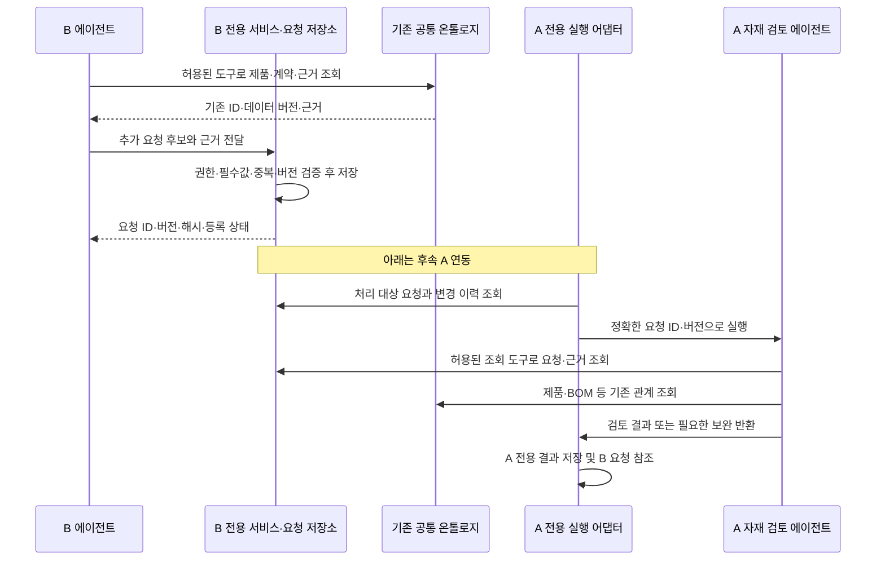

# B 개발자 전달 문서: 추가 생산 자재 검토 요청

작성일: 2026-11-02
문서 버전: 1.0 최종 전달본
구현 상태: 아래 전용 스키마·도구·연결 흐름은 신규 구현 계약이며, 아직 구현 완료된 기능이 아님

## 1. 개발 요청 요약

B가 추가 생산 필요성을 확인하면, **B 전용 요청 스키마**로 요청과 근거를 저장하고 A가 정확한 요청 버전을 조회할 수 있게 한다. A는 이를 받아 BOM 부품·공정 자재·공용 재고를 검토하고 **A 전용 검토 스키마**에 결과를 저장한다.

**공통 스키마와 공통 코드는 변경하지 않는다.** 신규 요청을 공통 그래프 노드로 등록하지 않는다. 기존 온톨로지에 있는 제품 구성·계약·근거를 참조하고, A/B 전용 업무 객체를 ID·버전으로 연결한다.

이번 B 개발 범위는 다음 두 단계다.

1. 추가 요청과 근거를 구성하고 검증한다.
2. B 전용 저장 계층에 등록하고 A가 읽을 수 있는 조회 계약을 제공한다.

A 실행 감지·접수·자재 계산·회신은 후속 A 연동 범위다. B의 ‘등록 완료’는 A의 ‘접수 완료’나 ‘검토 완료’가 아니다.

## 2. 통합 브랜치의 이름 기준

A/B 개발자는 `integration/a-b` 통합 브랜치를 기준으로 작업한다. 이 브랜치에서 A 자재 검토 패키지는 `ontologics.materials`이며 요청의 수신 역할도 `materials`로 통일한다. B의 고유 업무 모듈명은 변경하지 않는다.

| 구분 | 이번 인계에서 사용할 기준 |
| --- | --- |
| 업무상 받는 역할 | A 자재 검토 담당 |
| A 패키지 | `ontologics.materials` |
| 요청의 수신 역할 필드 | `target_role = "materials"` |
| A 실행 연결 | A 전용 어댑터가 materials 요청을 허용된 로컬 진입점에 연결 |

수신 역할 문자열 자체가 에이전트를 실행하지는 않는다. A 개발자가 기존 확장 접점으로 실행 어댑터를 구현하고 등록된 진입점에 연결해야 한다. 패키지명을 모델이 해석해 임의 코드를 실행하지 않는다. 같은 요청은 한 번만 접수·처리한다.

기존 이름 `production_planning`은 과거 자료 식별자나 호환 경로에 남을 수 있으나, 새 요청의 수신 역할·Python import·실행 명령에는 `materials`를 사용한다. 별도의 옛 이름 매핑 구현은 이번 신규 요청 계약의 요구사항이 아니다.

## 3. 어떤 스키마를 누가 변경하는가

| 소유자 | 변경할 내용 | 변경하지 않을 내용 |
| --- | --- | --- |
| B | 추가 요청 payload, 검증기, 요청 버전·상태·근거·중복 처리, 전용 저장 및 조회 | A 검토 결과·재고·RFQ, 공통 모델/스키마 |
| A | B 요청 접수 참조, 검토 결과, 보완 요청, RFQ 연결, 수신 역할 매핑 | B 원본 요청의 수량·버전·근거, 공통 모델/스키마 |
| 공통 | 이번 작업에 변경 없음. 기존 신원·권한·DB 연결·제품 조회 기능을 그대로 재사용 | 신규 요청 타입 등록, 공통 T-box/SHACL·그래프 저장 계약 확장 |

### 기존 schema.py에 단순 추가하면 안 되는 이유

현재 저장소의 역할별 `schema.py`는 공통 `domain_schema`에서 가져온 타입의 호환 정의를 포함한다. 그 파일의 `SCHEMA`에 새 타입을 추가해도 공통 저장·검증·조회가 지원되는 것이 아니다.

따라서 B에는 예를 들어 `additional_request_schema.py`처럼 **전용 업무 계약 파일을 별도로 추가**한다. A에는 필요할 때 `additional_request_review_schema.py` 같은 전용 계약 파일을 추가한다. 파일명은 예시이며 실제 모듈 구조에 맞추되, 공통 그래프 타입 정의와 분리해야 한다.

- B 전용 타입 예: `AdditionalMaterialReviewRequest` — B 로컬 업무 객체이며 공통 노드 타입이 아니다.
- A 전용 타입 예: `AdditionalMaterialReview` — A 로컬 검토 결과이며 B 요청 ID·버전·해시를 참조한다.
- 신규 요청을 기존 `ContractItem` 또는 `ProductionWork`로 위장해 저장하지 않는다.
- `model.py`, `domain_schema.py`, 공통 T-box/SHACL 생성기와 공통 서비스·런타임을 수정하지 않는다.

여기서 ‘전용 스키마’는 먼저 payload의 필드·관계·검증 규칙을 뜻한다. 저장이 필요하면 B 전용 PostgreSQL 테이블/마이그레이션도 B 모듈에서 관리한다. 공통 테이블의 컬럼이나 승인 스냅샷을 변경하지 않는다. 기존 DB 연결·신원·권한 검증 접점을 재사용하고, LLM에는 SQL·DB 자격 증명·직접 쓰기 권한을 주지 않는다.

## 4. 온톨로지와 에이전트의 연결 흐름



요청과 검토 결과는 각 업무 저장소에 있고, 기존 공통 온톨로지는 제품·구성·부품·근거의 의미와 관계를 제공한다. 이것을 **신규 요청까지 공통 그래프에 등록된 상태**라고 설명하면 안 된다. 에이전트는 허용된 전용 도구와 공통 조회 도구를 함께 사용해 연결을 따라간다.

온톨로지 자체는 A를 실행하지 않는다. A 전용 실행 어댑터가 B의 처리 대상 요청을 주기적으로 읽는 방식으로 시작할 수 있다. 감지·커서·재시도·실행 연결 역시 신규 구현이며 공통 런타임 코드를 변경하지 않고 기존 확장 접점과 역할 전용 코드로 연결한다. 현재 접점으로 부족한 부분은 미지원으로 보고하며 공통 코드를 몰래 확장하지 않는다.

## 5. B 전용 요청 스키마

아래 필드의 필수성은 **A 검토 대상 상태로 전환할 때** 적용한다. 작성 중에는 미확인을 보존할 수 있다. 필수값이 없으면 `needs_information`으로 저장한다.

| 필드 | 규칙 |
| --- | --- |
| `schema_version` | 전용 계약 버전. 예: `b-additional-material-request/1`. 공통 그래프 버전과 별개다. |
| `request_id`, `request_version` | B 전용 서비스가 부여. 요청 ID는 유지하고 수정 시 버전을 증가시킨다. |
| `request_kind` | `additional` 또는 `revision`. revision은 같은 요청의 이전 버전 참조가 필요하다. |
| `requester_ref`, `requested_at` | 인증된 요청자와 시간대 있는 요청 시각. 호스트/전용 서비스가 확정하며 모델이 신원을 지정하지 않는다. |
| `target_role` | `materials`. A 전용 실행 어댑터가 등록된 진입점으로 연결한다. |
| `configuration_id`, `reference_data_version` | 실제 공통 조회에서 확인한 제품 구성과 공개 데이터 버전. 이름 유사성으로 ID를 추측하지 않는다. |
| `related_plan_ref` | 기존 A 계획/문서의 소유 영역·ID·정확한 버전·내용 해시. 공통 그래프 노드라고 가정하지 않는다. 문서만 있으면 원문 근거와 명칭/작성일로 후보를 남기고 해결 전에는 미확인이다. |
| `additional_good_quantity`, `unit` | 이번 요청의 정상 완제품 수량. 양의 정수, 내부 단위 `piece`. bool·소수·0은 유효한 추가 요청량이 아니다. |
| `required_date`, `date_basis`, `timezone` | 날짜와 `production_complete` / `dispatch` / `customer_arrival` 중 하나. 날짜만 있으면 임의 시각을 만들지 않는다. |
| `destination_ref` | 고객 도착 기준이면 필수. ‘기존 동일’은 기존 목적지의 정확한 참조로 해석한다. |
| `reason`, `quantity_basis` | 요청 사유, 수량 산정식·기준 시점·검토 결과, 계산에 포함/제외한 기존 계획·요청과 근거. |
| `constraints` | `unchanged`, `changed`, `unknown`을 구분한다. unchanged는 비교 대상 계획 버전을, changed는 구체적 변경 조건과 근거를 가진다. |
| `related_request_refs` | 기존 B/C 요청 ID·버전·소유 영역 및 `revises`, `same_demand`, `independent` 관계. 미확인을 빈 목록으로 은폐하지 않는다. |
| `origin`, `evidence_refs` | 실제/가상 구분과 근거 참조. 가상 요청이 실제 제품에 연결돼도 요청은 synthetic이다. |
| `unknowns` | 미확인 필드·이유·보완 담당. 미확인 수량은 null이며 0으로 바꾸지 않는다. |

근거 참조는 저장 영역을 구분한다. 이미 공통에 등록된 근거는 `scope=common`과 Evidence ID·데이터 버전으로 참조한다. B 전용 원문/산정 기록은 `scope=b`와 문서 ID·버전·SHA-256·원문 위치(locator)를 보존하고 B 조회 도구로 읽는다. 전용 근거를 미등록 공통 Evidence라고 표시하지 않는다. 공통에 새 근거를 등록할 경우에만 기존의 정식 등록·검토 절차를 그대로 따른다.

### 수량과 날짜의 해석

- 기존 계획 100대 외에 30대가 필요하면 **30대**를 요청한다. 130대로 보내지 않는다.
- 이전 추가 요청 30대를 40대로 수정하면 같은 요청의 새 버전에 **40대**를 저장한다. 합계 70대 또는 추가 40대로 해석하지 않는다.
- 기존 추가 30대가 유효한 상태에서 독립적인 10대가 더 필요하면 별도 요청으로 **10대**와 독립 근거를 보낸다.
- 정상 완제품 목표와 생산 투입량은 다르다. B가 임의 수율·불량률·자재 여유율을 더하지 않는다.
- 고객 도착일을 자재 필요일로 바꾸지 않는다. 생산·물류 기간이 없으면 이후 A/생산 담당이 확인한다.
- 제품 구성 또는 필요 날짜/기준이 다르면 요청을 나눈다. 같은 구성·날짜라는 이유만으로 독립 수요를 중복 제거하지 않는다.
- 기존 작업에 추가하는지 별도 작업인지 알면 근거와 함께 보낸다. 모르면 선택 미확인으로 남긴다. 이 조건은 A의 공정 자재 준비량에 영향을 준다.

## 6. 저장 상태와 조회 계약

| B 요청 상태 | 의미 | A 자동 처리 후보 |
| --- | --- | --- |
| `draft` | 작성 중 | 아니오 |
| `needs_information` | 필수 정보 또는 중복 관계 미확인 | 아니오 |
| `ready_for_material_review` | B 서비스가 권한·내용·근거를 검증하고 전용 저장 트랜잭션을 완료 | 예. A 접수 완료를 의미하지 않음 |
| `superseded` | 새 버전으로 대체된 과거 요청 버전 | 아니오 |
| `cancelled` | 권한 있는 명시적 취소 기록이 있는 요청 | 아니오 |

이 상태는 B 전용 업무 상태다. 공통 그래프 승인·반영 상태나 Neo4j 동기화 상태로 표현하지 않는다. 공통 조회가 필요한 근거의 공개가 미완료이면 그 참조 검증을 완료했다고 표시하지 않는다.

B 전용 서비스는 다음 기능을 제공한다. 아래 이름은 논리 기능명이며 기존 구현 함수나 HTTP endpoint가 아니다.

- 요청 저장/수정: 후보, `request_key`, 수정 시 기대 이전 버전을 받고 요청 ID·버전·내용 해시·상태·검증 결과를 반환.
- 정확 버전 조회: 요청 ID·버전으로 불변 payload·해시·현재 유효 여부·후속 버전/취소 정보를 반환.
- 변경 목록 조회: 수신 역할과 안정적인 변경 커서로 신규·수정·취소 이력을 반환. ready 목록만 제공해 A가 취소를 놓치게 하지 않는다.
- 근거 조회: 권한 내 원문 또는 근거 위치·해시를 반환. A가 접근할 수 없는 근거는 접근 불가로 표시.

동일 키·동일 내용 재시도는 동일 결과를 반환한다. 같은 키에 다른 내용이면 충돌로 거부한다. 수정은 새 키와 새 버전으로 저장하며 기대 이전 버전이 다르면 다시 조회하게 한다. 원 수요와 B/C 요청 관계에 따른 업무 중복 검증은 멱등 키와 별개다.

A의 중복 처리 기준은 `(B 저장 영역, request_id, request_version)`이다. A가 접수할 때 현재 유효 여부를 다시 확인한다. 처리 중 수정·취소가 발생하면 이전 검토가 최신이라고 표시하지 않으며 예약 취소/재계산은 A의 별도 검토로 처리한다. B가 A 예약을 직접 변경하지 않는다.

## 7. A 전용 스키마에서 후속으로 추가할 내용

B에게 A 구현까지 요청하는 것은 아니다. 인계 형식을 맞추기 위해 다음 참조 필드를 합의한다.

| A 필드 | 의미 |
| --- | --- |
| `review_id`, `review_version` | A 검토 결과의 식별자와 버전 |
| `source_request_ref` | B 저장 영역·요청 ID·요청 버전·내용 해시 |
| `reference_data_version` | A 계산 시 사용한 공통 데이터 버전 |
| `calculation_basis_refs` | 생산 투입량 기준, BOM·공정 자재 기준, 재고/예약 조회 시점·버전 등 |
| `review_status`, `unresolved` | 검토 상태와 보완할 항목 |
| `material_result_refs`, `rfq_refs` | A에 저장된 자재 검토 결과 및 RFQ 초안 참조 |

요청 버전, 공통 데이터 버전, A 검토 버전은 서로 다른 값이다. A는 B 원본을 덮어쓰지 않고 자기 결과에서 정확한 요청 버전을 참조한다. B의 후속 결과 조회 방식은 이 참조를 기준으로 연결한다.

## 8. 요청 예시

아래는 설명용 가상 값이며 운영 ID·해시·버전으로 사용할 수 없다. 표시용 원문이나 모델 출력 자체를 신뢰하지 않고 B 서비스가 조회·대조한다. 운영 저장 응답에는 서비스가 계산한 내용 해시가 추가된다.

```json
{
  "schema_version": "b-additional-material-request/1",
  "request_id": "example:b-request:001",
  "request_version": 1,
  "request_kind": "additional",
  "requester_ref": "example:authenticated-b-user",
  "requested_at": "2026-11-02T15:00:00+09:00",
  "target_role": "materials",
  "configuration_id": "config:esp32-poe:L:WROOM",
  "reference_data_version": 3,
  "related_plan_ref": {
    "scope": "a",
    "document_id": "example:a-plan:001",
    "version": 1,
    "content_hash": "EXAMPLE_HASH_NOT_FOR_STORAGE"
  },
  "additional_good_quantity": 30,
  "unit": "piece",
  "required_date": "2026-11-20",
  "date_basis": "production_complete",
  "timezone": "Asia/Seoul",
  "destination_ref": null,
  "reason": "기존 계획에 포함되지 않은 추가 수요",
  "quantity_basis": {
    "as_of": "2026-11-02T15:00:00+09:00",
    "review_ref": "example:b-demand-review:001@1",
    "formula": "추가 확정 수요 30 - 해당 수요를 포함한 기존 요청 0 = 30",
    "checked_request_refs": [],
    "overlap_check": "verified_none"
  },
  "constraints": {
    "state": "unchanged",
    "baseline_plan_ref": "example:a-plan:001@1"
  },
  "related_request_refs": [],
  "origin": "synthetic",
  "evidence_refs": [
    {
      "scope": "b",
      "document_id": "example:b-demand-review:001",
      "version": 1,
      "sha256": "EXAMPLE_HASH_NOT_FOR_STORAGE",
      "locator": "추가 수요 및 기존 요청 대조 항목"
    }
  ],
  "unknowns": [
    {
      "field": "production_batch_relation",
      "reason": "기존 작업 합산 또는 별도 작업 여부 미확인",
      "owner": "production"
    }
  ]
}
```

필수 항목은 정상 수량·구성·기존 계획 참조·요청자·날짜/기준·수량 근거·중복 검증·변경 조건이다. 고객 도착 기준이면 목적지가 추가 필수다. 위 예시의 작업 합산 여부는 선택 조건으로, B 요청은 등록할 수 있지만 A가 준비량을 확정하기 전에 해소해야 한다.

## 9. B 개발 완료 확인 항목

1. 공통 코드·스키마·T-box/SHACL·공통 DB 테이블 변경이 없다.
2. 전용 요청은 B 저장소에만 생성된다. 공통 그래프에 미등록 타입이 삽입되지 않는다.
3. 기존 계획 100대에 추가 30대를 요청하면 payload의 추가량은 30대이며 기존 계획 수량은 바뀌지 않는다.
4. 같은 키 재시도는 같은 결과를 반환한다. 30→40 수정은 동일 요청의 새 버전이며 70대로 합산되지 않는다.
5. 구성·날짜가 다른 요청은 분리하고 독립 수요는 잘못 병합하지 않는다. B/C 중복 관계가 미확인이면 검증 완료로 처리하지 않는다.
6. 수량·구성·날짜 기준·필요한 목적지가 미확인이면 보완 필요로 처리하고 0/빈 문자열로 숨기지 않는다.
7. ‘기존 동일’은 정확한 계획·조건·목적지 참조로 해석한다. 근거를 못 찾으면 임의 확정하지 않는다.
8. 권한 없음, 근거 해시 불일치, 같은 키의 다른 내용, 기대 버전 충돌을 거부한다. 인증된 사용자와 모델이 주장한 신원을 구분한다.
9. A가 전용 조회로 요청·근거를 읽고 기존 공통 구성 ID를 조회할 수 있다. 공유 DB라는 이유만으로 A가 B 테이블에 직접 SQL을 실행하지 않는다.
10. B 저장 완료 후 A가 아직 실행되지 않아도 B는 접수/검토 완료라고 표시하지 않는다. 수정·취소도 변경 목록에서 조회 가능하다.
11. 수신 역할이 `materials`인 요청이 A의 허용된 진입점에 한 번만 연결된다. 미지원 역할은 임의 추정하지 않고 거부한다.
12. 요청 등록만으로 재고 예약·실사용 차감·RFQ 발송·발주·생산 승인·공통 계약 수량 수정이 발생하지 않는다.

B 개발자는 전용 스키마·검증기, 저장/조회 계약, 신규·수정·중복·미확인·취소 fixture와 검증 결과를 전달한다. A는 이 계약을 받아 별도로 접수 및 실행 어댑터를 구현한다. 전용 도구도 기존 권한 경계를 재사용하며 현재 권한이 부족하면 기능을 미지원으로 남기고 별도 변경 합의 없이 우회하지 않는다.

## 10. 구현 참고와 전달 범위

A/B 통합 브랜치의 참고 코드다. 팀원은 통합 브랜치를 받아 아래 `materials` 경로를 기준으로 개발한다.

- [서비스 Agent 실행 경계](../../../docs/AGENT_RUNTIME.md)
- [기존 공통 도구 계약](../../../docs/TOOLS.md)
- [현재 B schema 호환 정의](../../order_fulfillment/schema.py)
- [현재 A schema 호환 정의](../schema.py)
- [기존 공통 도메인 정의 — 수정 대상 아님](../../domain_schema.py)
- [기존 호스트 확장 접점](../../host.py)
- [A 전용 계획 문서 저장의 현재 경계](../library_plan_document.py)

이 최종 전달본은 앞선 ‘공통 요청 타입 추가’ 제안을 대체한다. 공통 그래프 변경·자동 이벤트 기능이 구현됐다는 의미가 아니며, 이 문서 작성만으로 B 전용 저장 권한이나 Agent 승인 권한이 부여되지 않는다. 문서만 작성했으며 B에게 자동 발송하지 않았다.
