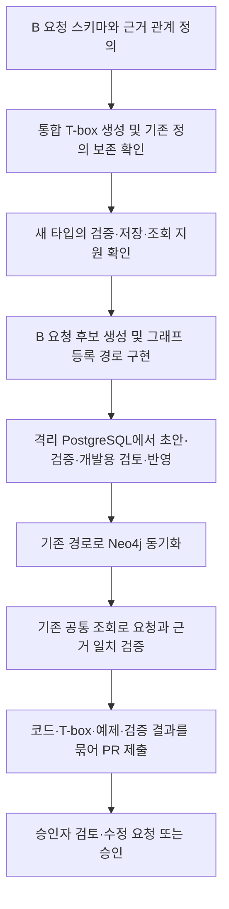

# B 개발자 전달 문서: 추가 생산 자재 검토 요청의 그래프 등록

작성일: 2026-11-02

문서 버전: 2.1 — B 스키마·통합 T-box 확장 및 그래프 등록·조회 검증

대상 브랜치: `integration/a-b`

이 문서는 기존의 B 전용 저장소 인계 설계를 대체한다. 아래는 개발 요구사항이며 구현 완료 보고가 아니다.

## 1. 이번 작업의 목표와 완료 범위

B가 A에게 보내는 추가 생산 자재 검토 요청을 **B 소유 스키마의 확장으로 정의**하고, **하나의 통합 T-box에 반영**한다. 요청과 근거를 기존 그래프 등록 절차로 저장한 뒤 Neo4j에 동기화하고, **기존 공통 조회 경로에서 그 요청을 읽을 수 있는지** 검증한다.

이번 작업은 A가 나중에 요청을 발견하고 처리할 수 있도록 데이터를 준비하는 단계다. **A 애플리케이션·에이전트 코드는 이번에 수정하지 않는다.**

| 이번 B 작업에 포함 | 후속 A 작업이며 이번에는 제외 |
| --- | --- |
| B 요청 타입·필드·관계·검증 정의 | A 사용자 명령 및 새 요청 발견 흐름 |
| 통합 T-box의 B 확장분 생성 | A 접수·읽음·검토 중·완료 상태 처리 |
| 요청 원문·근거·실제 등록 경로 구현 | BOM·공정 자재 필요량·부족량 계산 연결 |
| 격리 개발 DB에서 요청 등록 및 Neo4j 동기화 | 재고 예약·해제·실사용 차감 |
| 기존 공통 조회에서 요청·필드·근거 확인 | RFQ 생성·발송 및 B 회신 |
| 구현·검증 결과를 묶은 최종 PR | 운영 환경의 실제 업무 데이터 투입 |

**‘A 조회 검증’은 A가 확인했다는 업무 기록이 아니다.** A가 사용할 수 있는 기존 공통 조회 경로를 시험 코드에서 호출해 요청의 검색 가능성과 내용 일치를 확인한다. A 실행·접수 이벤트를 만들거나 `read_by_a=true`로 기록하지 않는다.

## 2. 명칭과 스키마 소유

- B 업무 패키지: `ontologics/order_fulfillment/`.
- A 자재 관리 패키지: `ontologics/materials/`.
- 요청의 수신 업무 역할: `materials`.
- 이 역할 값은 데이터 필드다. 에이전트를 자동 실행하거나 접근 권한을 부여하지 않는다.
- `production_planning`은 과거 이름이다. 새 인계 계약과 실행 문서에서는 `materials`를 사용한다.

요청 타입명은 예를 들어 `AdditionalMaterialReviewRequest`로 제안한다. B가 해당 타입의 필드·관계·업무 규칙을 소유한다. 기존 공통 타입·필드의 의미를 바꾸지 않고 **B 확장분만 추가**한다. B 전용 T-box 파일을 별도로 만들지 않으며 통합 `ontology/tbox.ttl`에 수렴시킨다.

### 현재 구현에서 반드시 확인할 연결 경계

현재 B `schema.py`는 `domain_schema`에서 B 정의를 가져오고, 실제 저장 검증은 `model.SCHEMA`를 기준으로 한다. `tbox.py`의 합성은 런타임 타입을 자동 등록하지 않는다. 따라서 **B 파일에 타입을 추가하고 TTL 생성에 성공한 것만으로 저장·조회 구현 완료라고 판단하지 않는다.**

먼저 최소 신규 요청 예제로 실제 검증·저장·RDF/Neo4j 조회가 B 확장 정의를 사용하는지 확인한다. 기존 접점으로 연결할 수 있다면 그대로 재사용한다. 공통 등록 메타데이터나 실행 코드 수정 없이는 `UNKNOWN_TYPE` 등으로 막힌다면 다음 원칙을 따른다.

1. 기존 공통 스키마·코드를 임의 수정하거나 허용 타입/검증을 monkeypatch하지 않는다.
2. 필요한 연결 위치와 오류, 재현 사례를 기록해 담당자와 범위를 확정한다. 기능별 정의 확장과 공통 저장 등록의 차이를 명시한다.
3. 별도 B 저장소나 Neo4j 직접 INSERT를 임의 대안으로 구현하지 않는다.
4. 해결되지 않았다면 그래프 등록·조회 완료로 보고하지 않는다. 완료 PR 전에 해결할 의존성으로 남긴다.

이 사전 연결 확인은 스키마만 완성한 중간 PR을 반드시 올리라는 뜻이 아니다. **원칙은 데이터 등록·조회까지 구현하고 검증한 후 최종 PR을 제출하는 것**이다. 다만 현재 허용 범위를 넘는 변경이 필요하면 구현 전에 그 범위를 먼저 조율한다.

## 3. 개발 순서와 PR 시점



**코드 PR 승인과 업무 데이터 승인은 별개**다. PR 전 개발 검증은 격리된 DB/schema/Neo4j namespace와 synthetic 요청을 사용한다. 작성자·검토자 분리 및 정확 버전 승인은 기존 경로로 검사하고 개발용 신원/검토 대역임을 기록한다. 모델이 `review`/`apply`를 호출하거나 승인 상태를 직접 쓰게 하지 않는다.

## 4. 요청에 필요한 필드와 관계

공통 `model.py`·`domain_schema.py`의 데이터 계약을 재사용한다. 아래는 업무상 필요한 정보이며, 모든 항목을 새 필수 필드나 사용자 입력란으로 만들라는 뜻이 아니다. 기존 참조로 확인할 수 있는 값은 재사용하고 이번 요청에서 달라지는 정보만 추가한다. 최종 필드명·직렬화·개정 표현은 B 스키마에서 정의하되 공통 코드를 변경하지 않는다.

### 기존 공통 데이터에서 재사용할 정보

| 기존 타입·기능 | 이번 요청에서 사용하는 방법 |
| --- | --- |
| `Configuration` | 대상 제품의 구성 ID를 연결한다. 제품명·개정/사양을 별도로 재정의하지 않는다. |
| `ContractItem` | 관련 계약 품목이 있으면 참조한다. 해당 품목의 `contract_id`, `configuration_id`, `quantity`, `unit`을 재사용한다. **계약 수량을 이번 추가 요청량으로 대신 사용하지 않는다.** |
| `DeliveryRound` | 관련 납품 차수가 있으면 참조한다. `contract_item_id`, `due_at`, `due_basis`, `destination`을 조회해 기존 납품 조건으로 사용한다. 이번 요청의 날짜·기준·도착지가 다르면 변경값을 명시한다. 기존 납품 노드를 수정해 추가 요청을 표현하지 않는다. |
| `SourceDocument`·`Evidence` | 요청 원문·수량 근거·전달받은 A 계획 문서를 연결한다. 해시·경로·출처 정보를 요청마다 중복 필드로 만들지 않는다. |
| 공통 신원·시간·등록 기능 | 실행 주체·등록 시각·승인·데이터 버전·재시도 처리는 기존 기능을 사용한다. B가 별도 인증·승인·감사 체계를 만들지 않는다. |

참조는 실제 등록된 ID를 사용한다. 요청 당시 조건을 재현할 수 있도록 참조한 공통 데이터 버전 또는 해당 내용을 보존한 원문 근거를 남긴다. 현재값만 읽어 과거 요청의 조건이 바뀌게 하지 않는다. 직접 지정한 제품과 계약 품목의 제품이 다르거나, 지정한 계약 품목과 납품 차수의 소속이 다르면 충돌을 표시하고 완전한 요청으로 등록하지 않는다.

### 요청에 필요한 최소 정보

| 항목 | 필요 수준 | 데이터와 검증 기준 |
| --- | --- | --- |
| 공통 노드 필드 | 공통 필수 | `id`, `type`, `origin`, `evidence`를 기존 규칙대로 사용한다. 별도 B 공통 필드 체계를 만들지 않는다. |
| 요청 식별 | 필수 | 요청을 고유하게 식별할 수 있어야 한다. 노드 ID 외 별도 업무 번호는 외부 문서 대응 등 실제 필요가 있을 때만 추가한다. 수정 요청의 표현은 아래 조건부 항목을 따른다. |
| 대상 제품 | 필수 | 실제 `Configuration` 관계로 식별한다. 관련 계약 품목·납품 차수는 있는 경우 연결하고 일치 여부를 검사한다. |
| 관련 기존 계획 | 필수 정보 | 어느 계획에 더하는지 확인 가능한 문서 참조 또는 근거를 연결한다. ID·해시·작성일·계약·품목을 모두 요청의 별도 필수 필드로 요구하지 않는다. 미확인이면 보완 대상으로 남긴다. |
| 이번 추가 요청량 | 필수 | 정상 완제품 기준 양의 정수와 단위 `piece`. 기존 계획에 더할 물량이며 계약 전체 수량이나 납품 차수 수량과 구분한다. |
| 필요한 날짜·기준 | 필수 정보 | 기존 `DeliveryRound`와 동일하면 해당 참조 및 요청 당시 근거로 확인한다. 다르면 이번 요청의 날짜와 기준을 명시한다. 날짜 기준은 생산 완료·출고·고객 도착을 구분하고, 기존 필드의 허용값과 의미를 확인해 대응한다. 날짜만 있으면 임의 시각을 추가하지 않는다. |
| 요청 사유·수량 근거 | 필수 정보 | 간단한 설명과 근거 연결로 추가량의 이유를 확인할 수 있어야 한다. 상세 산식·기준 시점·제외 물량은 근거 문서에 담을 수 있으며 각각을 필수 구조화 필드로 만들지 않는다. |
| 변경 조건 | 필수 정보 | 변경 없음 / 변경 내용 / 미확인을 구분한다. 변경 없음은 연결한 기준 계획의 조건을 재사용하고, 변경이 있으면 해당 내용만 명시한다. |
| 요청자·요청일 | 기존 기능 재사용 | 실행 주체와 등록 시각은 신뢰된 공통 경로에서 얻는다. 원래 업무 요청자·요청일이 실행자·등록일과 다르면 원문 근거로 구분한다. 실행자 정보를 업무 요청자라고 임의 대체하지 않는다. |
| 요청 준비 상태 | 최소 표현 | 검토 요청 가능한지 또는 보완이 필요한지 구분하고, 미확인 항목이 있으면 이유를 남긴다. 복잡한 B 결재 상태나 A 읽음·접수·처리 상태는 이번에 구현하지 않는다. |

### 해당할 때만 추가할 정보

| 조건 | 추가 정보 |
| --- | --- |
| 기존 요청 수정 | 이전 요청/개정을 식별하고 이번 수량이 기존 수량을 대체함을 명시한다. 별도 개정 번호가 필요한지는 저장 표현에 따라 결정하되, 그래프 데이터 버전을 업무 개정 번호로 대신 쓰지 않는다. |
| 관련 B/C 요청이 있음 | 수정·동일 수요·독립 수요 중 어떤 관계인지와 근거를 남긴다. 외부 문서 참조와 실제 내부 그래프 ID를 구분한다. 모든 수요를 자동 연결하는 엔진은 이번 범위가 아니다. |
| 고객 도착 기준 | 도착지가 확인되어야 한다. 기존 `DeliveryRound.destination`과 같으면 참조를 재사용하고, 다르면 이번 도착지를 명시한다. |
| 여러 수신 역할을 지원해야 함 | 수신 역할 필드를 둔다. A 전용 요청 타입으로 의미가 확정되어 있다면 `materials`를 중복 필수 필드로 요구하지 않는다. 어느 방식이든 저장 성공은 A 접수 성공이 아니다. |

실제 A 웹 `LibraryPlanDocument`는 문서 ID·created_at·content_hash를 갖는 자체 저장 레코드이며 일반적인 `document_version` 컬럼은 없다. 이번에는 A 코드나 문서 저장 구조를 변경하지 않고 전달받은 문서를 기존 근거 체계로 연결한다. 존재하지 않는 공통 계획 노드나 version=1을 만들지 않는다.

### 수량 규칙

- 기존 계획 100대 외에 30대가 더 필요하면 이번 요청은 **30대**다.
- 기존 추가 요청 30대를 40대로 수정하면 같은 업무 요청의 새 개정이며 **40대**다. 70대로 합산하지 않는다.
- 기존 30대 요청과 독립된 추가 수요 10대라면 별도 요청 **10대**와 독립 근거를 남긴다.
- 납기 내 부족량·미배정량·잔여 약속량은 자동으로 추가 생산량이 아니다. B가 확보한 생산 예정·기납품·운송 중·재고·관련 요청 근거를 바탕으로 추가량의 이유를 설명한다. 확인하지 못한 범위는 미확인으로 남긴다. 이번 작업에서 전사 요청 전체의 중복 수요를 자동 판별하는 기능까지 요구하지 않는다.
- 정상 완제품 목표와 생산 투입량은 다르다. B가 임의 불량률·수율·자재 여유율을 더하지 않는다.
- 미확인 수량은 0으로 바꾸지 않는다. 필수값 미확인 시 보완 대상으로 남기고 완전한 요청으로 표시하지 않는다.
- 제품 구성 또는 필요 날짜/기준이 다르면 요청을 나눈다. 같은 구성·날짜라는 이유만으로 독립 수요를 병합하지 않는다.

### 지원 범위

고객 도착일을 자재 필요일로 바꾸는 것은 이번 범위가 아니다. 기존 작업에 합칠지 별도 작업인지 알면 근거를 남기되 모르면 미확인으로 둔다. A의 준비량·생산 투입량 계산 연결은 후속 작업이다.

현재 C PR #6의 중단 요청 등은 존재하지만 `ReproductionRequirement`와 시험 결과 타입은 미지원이다. B·C 작업 연결(I02)과 보드별 재고/출하 소속(I04)도 미합의다. 이 작업에서 C의 기존 검증 거부를 해제하지 않는다. 확인 가능한 C 외부 문서는 원문 근거로 보존하고, 실제 등록된 재생산 노드인 것처럼 참조하지 않는다.

## 5. T-box 생성과 실제 등록 구현

통합 T-box는 기존 공식 생성기를 사용한다.

```bash
python -m ontologics.tbox
python -m ontologics.tbox --check
```

기존 클래스·속성·참조 의미가 유지되고 B 확장분만 추가됐는지 diff를 검사한다. TTL 파일을 손으로만 수정하거나 과거 B 문서의 별도 exporter 안내로 공통 선언을 덮어쓰지 않는다. 현재 공통 graph-0.3 기준과 새 확장에 필요한 버전/호환 정책을 대조하며, 자료를 등록할 때마다 스키마 버전을 올리지 않는다.

B 요청 후보 생성은 현재 B의 입력 task/검증 패턴을 재사용할 수 있다. 모델은 원문 해석·후보·보완 사유를 만들고 신뢰된 코드가 실제 값·근거·허용 필드와 대조한다. `AgentSpec` 추가가 그래프 타입 등록 또는 쓰기 권한을 부여하는 것은 아니다.

실제 그래프 등록은 기존 `prepare_draft → validate_draft → 권한 있는 검토 → CommonHost.apply_approved` 흐름을 사용한다. 정확 초안 버전·내용·기준 데이터 버전·작성자와 검토자 분리·요청 키를 유지한다. `ok=true`만 보지 않고 validation 결과와 반영된 데이터 버전까지 확인한다. 모델에게 승인·반영 도구를 노출하지 않는다.

기존 `AgentGateway`는 임의 신규 도구 등록을 허용하지 않는다. 이번에는 `b_request_get` 같은 새 모델 도구를 만들지 않고, 등록된 요청을 기존 `lookup`으로 조회하는 경로를 검증한다. 허용 타입·검증·RDF/Neo4j 표현에 빠진 연결이 있으면 2절의 의존성으로 명확히 보고한다.

원문은 변경 없이 보존하고 새 SourceDocument/Evidence ID·해시·위치·origin을 연결한다. synthetic 요청이 real 제품 구성을 참조해도 요청 자체가 real이 되는 것은 아니다. B의 미등록 입력 출처를 공통 확정 EvidenceRef로 미리 표시하지 않는다.

## 6. Neo4j 동기화

동기화 기능을 새로 만들지 않는다. PostgreSQL의 승인·반영된 데이터 버전을 기존 동기화 경로로 공개한다. 개발용 seed는 별도 상태이며, seed 성공만으로 요청의 승인·반영 경로까지 검증했다고 보고하지 않는다.

- Neo4j 모드 `CommonHost.apply_approved()`는 PostgreSQL 반영 후 새 버전 동기화를 시도한다.
- `data.graph_projection.status=ready`와 `pending`을 구분한다. pending이면 해당 버전의 그래프 조회 완료가 아니다.
- PostgreSQL 모드/저수준 반영 또는 과거 버전은 필요한 버전을 CLI로 명시적으로 동기화할 수 있다.
- 테스트에는 소유한 격리 DB/schema와 새 Neo4j namespace를 사용한다. 기존 개발·운영 namespace를 덮어쓰지 않는다.

다음은 실행 형식이다. `<...>`는 해당 격리 환경의 실제 값으로 치환한다. 환경 파일은 Git에 넣지 않으며 비밀값을 로그에 출력하지 않는다.

```bash
python -m ontologics.graph_projection sync \
  --schema <격리_PG_스키마> --version <반영된_데이터버전> \
  --request-key <해당_동기화의_고유키> \
  --env-file <개발환경파일> --graph-env-file <Neo4j환경파일>

python -m ontologics.graph_projection status \
  --schema <격리_PG_스키마> --version <반영된_데이터버전> \
  --env-file <개발환경파일> --graph-env-file <Neo4j환경파일>
```

`status`는 실제 조회와 내용 무결성을 확인한다. 같은 성공 sync 키의 재호출은 과거 결과를 재생하므로 현재 상태 확인을 대신하지 않는다. 동일 동작의 실패 재시도와, 성공 후 별도 재동기화의 새 키 사용을 구분한다. 실패했다고 다른 데이터 버전이나 PostgreSQL로 조용히 우회하지 않는다.

## 7. 이번 조회 검증의 정확한 의미

**B 요청 등록 후 기존 공통 조회 경로에서 검색·내용 일치를 검증한다. A 코드를 실행·수정하거나 A 확인 상태를 기록하는 검사가 아니다.**

신뢰된 테스트 호스트에 읽기 권한을 가진 별도 주체를 설정하고, 같은 저장소·데이터 버전의 Neo4j backend로 기존 조회를 수행한다. 관리자 Cypher 조회 성공만으로 완료 처리하지 않는다.

```python
# 기존 호스트가 만든 권한 있는 RequestSession을 사용하는 시험 예시.
# 새 요청 타입명과 실제 저장된 ID/버전으로 실행한다.
by_id = session.call('lookup', {'node_id': stored_request_id, 'version': applied_version})
by_type = session.call('lookup', {'kind': request_type_name, 'version': applied_version})
```

ID 조회뿐 아니라 타입 조회에서도 요청을 찾을 수 있어야 한다. 기존 lookup에 수신 역할·상태 필터가 없다면 시험 코드에서 반환값을 대조한다. 아직 존재하지 않는 조회 인자를 추가하거나 필터 API가 구현됐다고 문서화하지 않는다.

검사할 내용:

1. 등록한 요청 ID와 제품 구성, 추가 수량, 날짜/기준, 수신 역할, B 요청 상태가 일치한다.
2. 요청에서 Evidence와 SourceDocument를 기존 도구로 조회하고 원문 위치·해시·origin을 추적할 수 있다.
3. PostgreSQL과 Neo4j 조회가 같은 버전에서 같은 내용을 반환한다.
4. 요청 개정과 공통 데이터 버전을 혼동하지 않는다. 다른 DB/schema의 같은 숫자 버전도 동일시하지 않는다.
5. 읽기 권한 없음·공개 pending·잘못된 버전·깨진 참조는 성공으로 처리되지 않는다.
6. 조회 전후 요청 및 업무 데이터가 바뀌지 않는다. 기존 조회 감사 로그 외에 A 읽음·접수·예약·RFQ 등의 업무 사건이 생성되지 않는다.

결과 보고에는 ‘읽기 가능 검증 완료’라고 쓰고 ‘A 확인 완료’·‘A 연동 완료’·‘자재 검토 완료’라고 쓰지 않는다. 실제 A 사용자·권한 설정·발견·접수 흐름은 후속 A 개발에서 별도로 검증한다.

## 8. 수정·재시도·중복 및 완료 검사

같은 작업 재시도에는 같은 request_key와 같은 내용을 사용한다. 내용 변경은 새 키와 명시적인 요청 개정으로 표현한다. 기대 이전 버전이 다르면 충돌로 처리한다. 과거 요청과 근거를 덮어쓰거나 모델이 임의로 superseded 상태를 만들게 하지 않는다. 구체적인 개정 표현은 기존 그래프의 타입·origin·근거·버전 규칙을 준수하도록 B 스키마와 시험에서 확정한다.

최종 PR 전에 확인할 사항:

- B 확장 정의와 통합 T-box의 일치, 기존 정의 보존.
- 신규 타입에 대한 실제 검증·저장·Neo4j 표현·조회 지원. TTL 생성만으로 대체하지 않음.
- 신규 30대 요청, 30→40 수정, 독립 10대 추가, 중복 재시도의 기대 결과.
- 필수값·근거 누락, 미확인과 0, 다른 구성/날짜, C 미지원 관계 처리.
- 자기 승인·구 초안 버전·권한 부족·잘못된 기준 버전 차단.
- 정상 등록·반영·동기화·ready 확인 및 기존 공통 조회의 ID/타입·근거 대조.
- 조회만으로 A 업무 상태나 재고·RFQ에 변화가 없는지 확인.
- A 애플리케이션·에이전트 수정 없음, 실제 운영 DB/namespace 변경 없음.

## 9. PR에 포함할 산출물

1. B 스키마·검증·요청 생성/등록 코드와 확장 연결 설명.
2. 공식 생성기로 만든 통합 T-box diff 및 호환성 검증 결과.
3. 원문·근거·대표 요청 데이터와 재현 가능한 격리 환경 실행 예제.
4. 등록된 요청 ID, 요청 개정, 반영 데이터 버전, 동기화 ready, 공통 조회 결과의 검증 기록. DB 접속 비밀값은 제외한다.
5. 실패 사례·회귀 검사 결과와 남은 제약. 실모델 호출과 모델 대역을 구분한다.
6. A 후속 구현에 필요한 필드 계약. A 확인/접수/계산 기능은 이번 PR에서 완료했다고 쓰지 않는다.

**코드·데이터 등록·조회 검증까지 완료한 다음 PR을 제출한다.** 승인자가 전체 변경과 증거를 보고 수정 요청 또는 승인한다. 현재 제약 때문에 연결을 완료하지 못했다면 미완료 범위를 명시하며 완료 PR로 표현하지 않는다.

## 10. 기준 문서와 현재 구현

- [개발 지침](../../../AGENTS.md): 원본·근거 보존과 변경 영향 검증.
- [Neo4j 설정 및 sync/status 실행](../../../README.md#rdfneo4j-조회를-선택해-실행)
- [공통 도구·동기화·공개 계약](../../../docs/TOOLS.md)
- [Agent 실행·권한 경계](../../../docs/AGENT_RUNTIME.md)
- [B schema](../../order_fulfillment/schema.py), [현재 공통 타입 정의](../../domain_schema.py)
- [통합 T-box 생성기](../../tbox.py): 생성과 런타임 타입 등록은 별개.
- [Neo4j 동기화 CLI](../../graph_projection.py), [호스트](../../host.py), [저장·조회 서비스](../../service.py)
- [A 계획 문서의 현재 식별 구조](../library_plan_document.py)
- [C 지원 데이터 범위](../../../docs/claim_response/DATA_POLICY.md)

현재 기준은 main 05d55c7과 integration/a-b의 코드다. B 문서의 graph-0.1/graph-0.5 과거 실행 이력을 최신 등록 지원으로 해석하지 않는다. 별도 Skill 생성은 선행 조건이 아니며 기존 코드·지침을 재사용한다. Skill이나 프롬프트로 타입·권한을 추가할 수 없다.

이 문서는 요구사항을 수정한 것이며, 요청 타입·데이터 등록·동기화 기능을 이번 문서 작업에서 구현하거나 실행한 것은 아니다.
